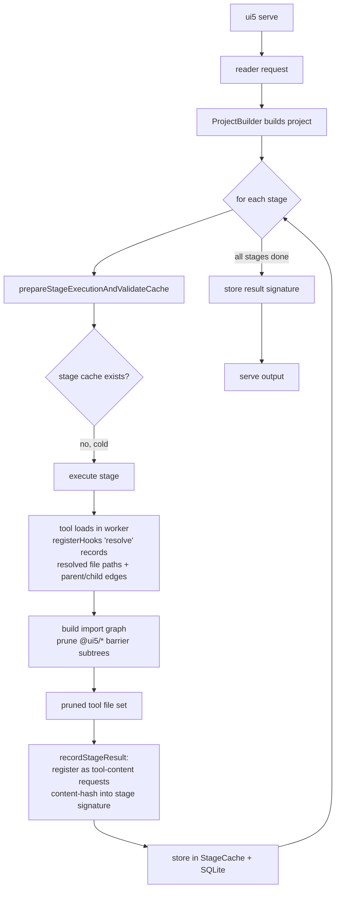
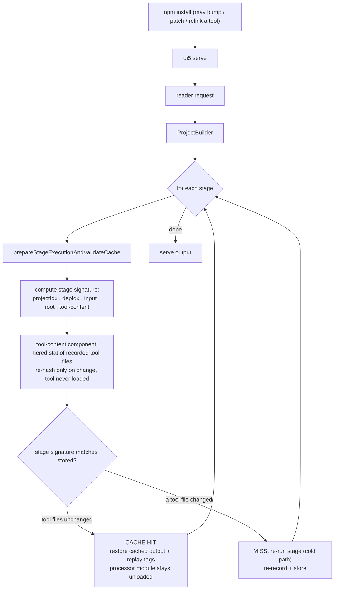

# Build cache: tracking a task's code/tool dependencies

**CPOUI5FOUNDATION-1386** — design review for the FND team.

---

## TL;DR

- **Problem.** The build cache ignores the *external tools* a task loads to transform content
  (`buildThemes` -> less-openui5, `minify` -> terser, `jsdoc` -> jsdoc). Bump less-openui5 *without* a
  new `@ui5/builder` release and `ui5 serve` serves CSS compiled by the old version — a stale cache hit.
- **Recommendation.** Per stage: **observe** which tool packages the task actually loads (module-resolution
  hook in the worker, prune the `@ui5/*` framework subtrees), then **content-hash those files** into the
  stage signature via a dedicated `tool-content` request — reusing the existing `HashTree` machinery. No
  version strings, no per-task declaration.
- **Why this one.** It fails **safe** (worst case is a spurious rebuild of one stage, never stale output),
  needs **no annotation** to maintain, is **strictly correct** (also catches `file:` / `link:` / patched
  tools), and is **cheap** (measured: sub-ms warm lookup, single-digit-ms hash).
- **Decisions we want from the team.**
  1. Content-hash over versions-only (strictly more correct; cost measured negligible).
  2. A dedicated `tool-content` signature component vs. folding into `rootSignature`.
  3. Green-light the record-side worker instrumentation (`module.registerHooks` in the two workers).

---

## The problem

A build task loads an external tool and uses it to produce output. The tool's **version is an input** —
a new less-openui5 can compile different CSS from unchanged `.less` sources — but the cache never sees it.

The build signature already folds the `@ui5/builder` / `@ui5/fs` / `@ui5/project` versions, so a code
change *inside* those ships as a new `@ui5/builder` version and invalidates the cache. The gap is their
**dependencies**: less-openui5 is a dep of `@ui5/builder`, so bumping less-openui5 alone — no new builder
release — leaves every signature unchanged. Cache hit, stale output.

**Canonical example:** `.less` unchanged, less-openui5 upgraded to a version that compiles different CSS,
no new `@ui5/builder` release -> the build ships CSS from the old less-openui5.

**Scope:** external deps outside `@ui5/builder` / `@ui5/project` / `@ui5/fs`. Target tasks: `buildThemes`
(less-openui5), `minify` (terser), `jsdoc`.

---

## Options

The ticket's options split across **two independent axes**. Pick one from each.

- **Axis 1 — how to determine a task's dependency tree** (which external packages it pulls in).
  Options 1, 2, 3 are three answers.
- **Axis 2 — what to fold per dependency** (how to detect that it changed): a version string, or a
  content hash. Option 4 is the content-hash answer.

Options 1-3 are *not* alternatives to Option 4 — they sit on different axes. The original options
implicitly assumed a version string on axis 2; Option 4 swaps that out.

### Axis 1 — determining the dependency tree

| | 1 — Declaration | 2 — package-lock | 3 — registerHooks (chosen) |
|---|---|---|---|
| How | task declares its tools | parse the lockfile | observe module resolution |
| Scope | per task, manual | whole project tree (can't narrow) | per stage (exactly what loaded) |
| Failure mode | **unsafe** (stale) | safe but coarse | safe (over-capture) |
| Needs a prior build | no | no | yes (record pass) |
| Maintenance | high, rots | none | none |
| Custom tasks (1396) | author must declare | — | free |

- **Option 1** rejected: a forgotten/stale declaration silently serves stale output — the ticket's own
  bug, no backstop.
- **Option 2** rejected as a scoping mechanism: the lockfile is the whole tree, so it can't say which deps
  belong to a stage; also fragile (absent / format varies across npm/yarn/pnpm). At most a version source.
- **Option 3** chosen: observes exactly what each stage loads, no declaration, extends to custom tasks for
  free. Cost: complexity + a prior run; out-of-process tools (jsdoc) handled separately.

### Axis 2 — what to fold per dependency

| | Versions | Content-hash (Option 4, chosen) |
|---|---|---|
| Detects a registry version bump | yes | yes |
| Detects `file:` / `link:` / patched (no version move) | **no** | **yes** |
| New logic | specifier-authority mapping, re-resolution, `tool-deps` type | reuses `HashTree`; a `tool-content` request type |
| Cost (measured) | a few `package.json` reads | sub-ms warm stat, single-digit-ms hash |

A content hash **subsumes** the version — any version change is a content change, and so are the cases a
version string misses — so Option 4 *replaces* version tracking rather than complementing it: strictly
more correct and, once scoped by Option 3, cheap (Appendix C).

**-> Option 3 to determine the tree, content-hash (Option 4) to fold.**

---

## Recommended design

Two halves, split by where the complexity lands:

**Scope (record side, in the worker).** `module.registerHooks({resolve})` observes which modules a stage
loads. Build the import graph from `ctx.parentURL`, treat `@ui5/fs` / `@ui5/project` / `@ui5/logger` as
**barriers** (prune their subtrees — their effect is already covered, see Appendix B), traverse *through*
`@ui5/builder` to reach the tools. Validated: this collapses `buildThemes` from 38 resolved packages to
the 2 that are actually the tool.

**Fold (content hash).** Content-hash the surviving tool files into the stage signature as a dedicated
`tool-content` request, reusing the existing `HashTree` / tiered `isResourceUnchanged` / full-refresh
machinery. No version strings, no re-resolution. jsdoc is out-of-process (can't be observed), so its
package files are hashed from the statically-known `jsdoc` root instead.

Why these properties matter for a cache:

| Property | Why it matters |
|---|---|
| **Fails safe** | A wrong guess is a spurious rebuild of one stage, never stale output. Option 1 could serve stale. |
| **No declaration** | Nothing to forget or let rot; custom tasks (1396) get it for free. |
| **Strictly correct** | Content catches version bumps *and* `file:` / `link:` / patched tools. |
| **Cheap** | Measured: tool packages are tens of files; sub-ms warm stat, single-digit-ms hash. |
| **Reuses machinery** | `tool-content` is just another resource index; no new signature concept. |

---

## How it works: `npm install` then `ui5 serve`

The cold build **records** each stage's tool file set (tool runs in the worker, the hook observes the
loads) and content-hashes it. The warm build only **re-checks** those files with the tiered stat
(re-hash on change) — detecting a tool change **without loading the tool**.

### Initial build (cold cache)

### Warm cache (after `npm install`)

| What `npm install` changed | Result |
|---|---|
| Nothing relevant | Full cache hit -> serve instantly, zero task execution |
| A tracked tool (bump, patch, or relinked `file:` / `link:`) | Only that stage's `tool-content` component shifts -> only that stage re-runs; others stay cached |
| Source files | Resource-index delta (existing mechanism) -> affected stages re-run, orthogonal |

---

## Implementation plan

| Phase | What | Standalone? |
|---|---|---|
| 1 | **Recorder** — `registerHooks({resolve})`, record resolved file paths + parent/child package edges, scoped per stage | yes, unit-testable |
| 2 | **Graph + prune** — build the DAG, prune `@ui5/*` barriers, output the stage's tool file set | yes, unit-testable |
| 3 | **Wire in** — register in `themeBuilderWorker.js` + `minifierWorker.js` + main; drain the set back with the worker result | — |
| 4 | **Fold** — dedicated `tool-content` request type + adapter + signature component (Appendix D) | — |
| 5 | **jsdoc** — content-hash the statically-known `jsdoc` package files (out-of-process, Appendix E) | — |
| 6 | **Verify** — overhead, async-interleaving attribution, full suite on real Node 22/24 | — |

**Residual decision (parked, Appendix C/decision 7):** after pruning, builder plumbing like `workerpool`
is still hashed (the loader can't tell plumbing from tool). Accepted — it's correctness-safe over-capture;
a central denylist is the lever if it ever proves noisy.

**Out of scope:** non-deterministic package content (postinstall-generated files — a portability edge);
out-of-process transitive deps of jsdoc unless the static dep-walk is added; custom tasks (follow-up 1396).

---

## Appendix A — Validation findings (checked with spikes, not assumed)

1. **`module.registerHooks` available** on Node 26 and the engines range (`^22.22.3 || ^24.15.0 || >=26`;
   API shipped 22.15 / 23.5).
2. **Tools load in worker threads; hooks are per-thread.** A main-thread hook is blind to a worker's
   imports; register **inside the worker**.
3. **Record via `resolve`, not `load`.** The import cache suppresses `load` after the first loader (1 of 3
   imports); `resolve` fires every time (3 of 3), cache-proof.
4. **Path -> package needs specifier authority.** terser ships `dist/package.json` named `"dist"`, so the
   naive "nearest named `package.json`" mis-reads it. (Moot under content-hash — see Appendix D — it only
   affects barrier identity, where a mis-map is a harmless over-capture.)
5. **The flat resolved set is framework-dominated.** A real `buildThemes` run resolves 38 packages; only 2
   are the tool. The other 36 are `@ui5/fs` + its closure (fast-glob, micromatch, ...).
6. **`ctx.parentURL` present on every `resolve`,** so the import graph is reconstructable. Pruning `@ui5/*`
   barriers collapses buildThemes 36 -> 2; minify -> 7 (terser + five `@jridgewell/*` + residual
   `workerpool`).
7. **jsdoc runs out-of-process** (`jsdocGenerator.js` does `spawn("node", …)`). A hook in the build process
   can't see the child; the only uncovered tool is the `jsdoc` package itself (its UI5 plugin/template are
   builder code, already covered).

## Appendix B — Why prune, not track the whole tree

Tracking the whole tree sounds safer but is wrong: an input earns tracking only when its change isn't
already observed elsewhere, and most of the tree is. The **resource Merkle indices** already capture
anything whose effect reaches the build through resource content/existence — the entire `@ui5/fs` layer
acts this way. The **project build signature** already folds the `@ui5/{builder,fs,project}` versions. The
ticket's gap is narrow: a **content-transform tool** reads unchanged input and emits different output —
invisible to the resource index. Pruning the `@ui5/fs` subtree removes redundant coverage, not real
coverage. The tool's own transform deps are *not* pruned (they're in the tool subtree), so an overridden
`postcss` under less-openui5 is still caught.

## Appendix C — Options, in detail

Options 1-3 are axis 1 (determining the dependency tree); Option 4 is axis 2 (what to fold).

- **Option 1 — Declaration.** Deterministic, no hooks, uniform across in/out-of-process. Decisive con:
  **unsafe failure mode** — a forgotten/stale declaration -> stale stage, no backstop; burden lands on
  custom-task authors.
- **Option 2 — package-lock.** Exact versions + integrity, transitive tree present. Decisive con: **can't
  scope** (folding the whole tree keys the cache on every dep); also fragile (absent / format varies).
- **Option 3 — registerHooks.** Scopes precisely for free; safe; extends to custom tasks. Con: complexity
  and needs a prior run; doesn't cover out-of-process tools (jsdoc handled separately).
- **Option 4 — content-hash.** Subsumes the version, so it *replaces* version tracking. Feasibility
  measured on the real tools:

  | | files | size | hash | stat (warm lookup) |
  |---|---|---|---|---|
  | terser | 43 | 2.3 MiB | ~40 ms cold / ~2 ms warm | 0.2 ms |
  | less-openui5 | 63 | 0.35 MiB | ~26 ms cold / ~2 ms warm | 0.2 ms |

  Pruning keeps the set to tens of files, so warm lookup is sub-ms (tiered stat) and a full hash is
  single-digit-ms. Caveats (none decisive): redundant-but-cheap for registry installs; one re-hash after a
  same-version `npm ci` (no false re-run); non-deterministic package content hurts portability (rare).

- **Residual (decision 7):** builder plumbing (`workerpool`) survives the prune because the loader can't
  tell plumbing from tool. **Accept** (A) — correctness-safe over-capture bounded to one stage; a central
  **denylist** (C) is the safe lever; a per-task **declaration** (B) is rejected (reintroduces the unsafe
  failure mode).

## Appendix D — Why a dedicated `tool-content` request type

Reuse the content-hash *machinery* (`HashTree`, tiered `isResourceUnchanged`, full-refresh), but **not**
the existing `root` requests, for three reasons:

1. **Provenance** — `root` means "files the task read via `getRootReader`"; tool files are runtime-loaded
   modules — a different category, and entangling them loses the distinction.
2. **Reader scope** — the root reader is rooted at the project; under a **global install or `npx`**, the
   tool files live outside the project tree and the root reader can't resolve them.
3. **Gitignore** — `root` splits on `useGitignore`, and `node_modules` is normally gitignored.

So: a dedicated `tool-content` request type with its own adapter (reaching the resolved absolute paths,
gitignore ignored), folded as a **dedicated signature component** (preferred — a factor-1 constant in the
result-stage product, shape bump free while unreleased) or into the `rootSignature` value (acceptable).

## Appendix E — jsdoc detail

jsdoc is out-of-process (`spawn("node", [import.meta.resolve("jsdoc/jsdoc.js"), …])`), so `registerHooks`
can't observe it. The fold is identical to the in-process tools; only the file set is determined
differently: the `jsdoc` package root is known statically, so register its files as `tool-content`
requests and content-hash them — no version fold, no child instrumentation. Transitive deps aren't
observable out-of-process; a static dep-walk of jsdoc's `package.json` closure would cover them if wanted,
otherwise accept the narrowing (jsdoc's own content only).
