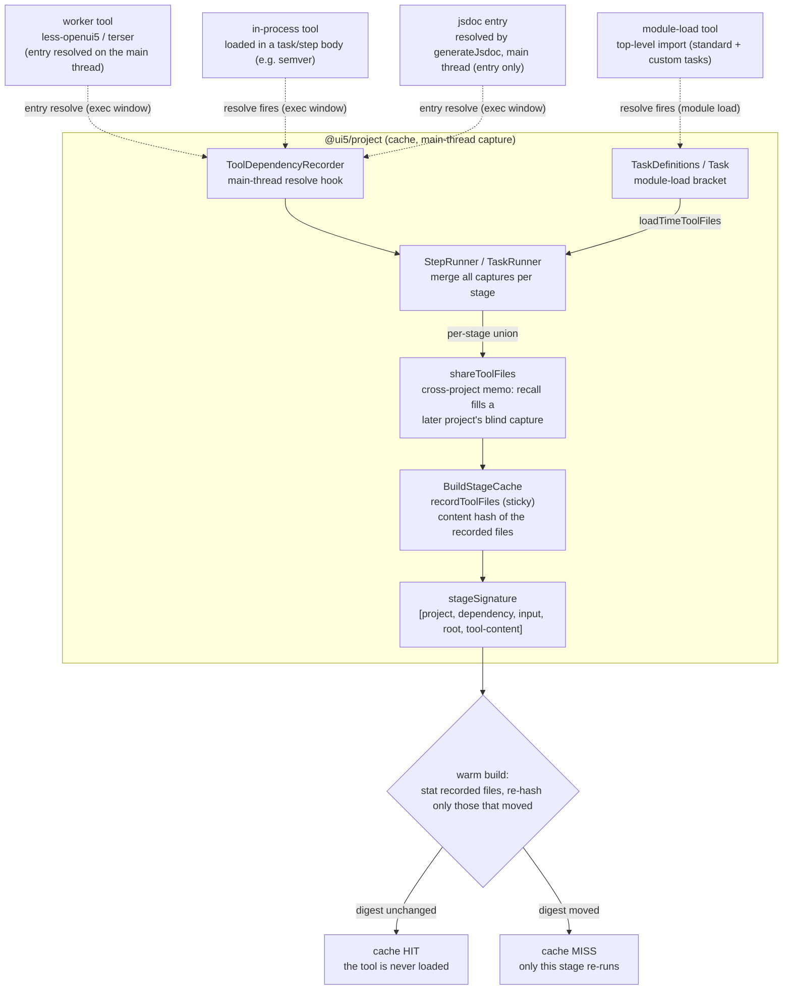

# Build cache: tracking a task's external tool dependencies

A build task loads an external tool (less-openui5, terser, jsdoc) and transforms content with it. The tool's version is an input to the build, but the cache never saw it, so upgrading a tool without a new `@ui5/builder` release served stale output. This document covers the problem, the solution, and the remaining gaps.

Tracked in CPOUI5FOUNDATION-1386. In-process tasks (standard and custom, including top-level imports) are tracked at full subtree level; the worker tools (less-openui5, terser) and jsdoc are tracked at version level, incidentally, through a main-thread entry resolve. The one gap: a custom task that loads its tool only inside a worker it spawns itself is not auto-tracked, so the convention is to resolve the tool on the main thread (§2.6). Cross-machine cache portability is the remaining follow-up.

---

## 1. The problem

A build task loads an external tool and produces output with it. The tool's **version is an input**: a new less-openui5 can compile different CSS from unchanged `.less` sources. The build signature already folds the `@ui5/builder` / `@ui5/fs` / `@ui5/project` versions, so a change *inside* those ships as a new `@ui5/builder` release and invalidates the cache. The gap is their **dependencies**: less-openui5 is a dependency of `@ui5/builder`, so bumping less-openui5 alone, with no new builder release, leaves every signature unchanged. Cache hit, stale output.

Canonical example: `.less` unchanged, less-openui5 upgraded to a version that compiles different CSS, no new `@ui5/builder` release, so the build ships CSS from the old less-openui5.

Target tasks: `buildThemes` (less-openui5), `minify` (terser), `jsdoc`, and custom tasks. A fix answers two independent questions, and conflating them is what made the ticket feel large:

- **Scoping**: which external packages does a stage use?
- **Change detection**: how do you tell a tracked package changed?

---

## 2. The solution

Per stage, observe which tool files the task actually loads, then content-hash those files into the stage signature as a dedicated `tool-content` component. No version strings, no per-task declaration. The design fails safe: a wrong guess is a spurious rebuild of one stage, never stale output.

Two packages are involved. `@ui5/project` owns the cache and the main-thread capture; `@ui5/builder` owns the workers. A worker tool loads in a realm the main-thread recorder cannot observe, so the dispatch resolves the tool's entry on the main thread (the jsdoc approach, 2.3); every tool then reaches the cache through one of two main-thread capture points. The diagram traces the capture paths (in-process execution-window and in-process module-load; the worker tools and jsdoc ride the execution-window path via an entry resolve) through the per-stage merge and the cross-project share memo to the `tool-content` signature and the warm-build cache decision. Dotted edges are observations (a resolve hook firing); solid edges are direct calls.



### 2.1 Scoping: observe what each stage loads

`module.registerHooks({resolve})` observes every module resolution in a realm. While a stage runs, the resolved `file:` paths under `node_modules` are the candidate tool files. One refinement keeps the set to the actual tool:

- **Barriers.** The UI5 tooling packages (`@ui5/builder`, `@ui5/fs`, `@ui5/project`, `@ui5/logger`) are dropped, because their effect on the build is already covered by the `@ui5/*` version fold and the resource indices, so re-tracking their files would be redundant. The recorder keys the barrier on each file's owning package (its last `node_modules` segment), so it is scoped to the tooling packages only: an `@ui5`-scoped *application* dependency a task bundles (e.g. `@ui5/webcomponents` via `ui5-tooling-modules`) is tracked like any other package, and a tool hoisted under a tooling package (`.../@ui5/builder/node_modules/terser/...`) is attributed to `terser`, not the barrier. An earlier flat `@ui5/*` filter dropped the whole scope, which silently excluded bundled `@ui5` application packages; the owning-package match fixes that. Nothing else is special-cased: build plumbing such as `workerpool` is tracked like any other package, so at worst a bump of it re-runs a worker-dispatching task (fail-safe). The worst case is over-capture, never dropping a tool.

Chosen over two alternatives. A per-task **declaration** was rejected: a forgotten or stale declaration silently serves stale output, the ticket's own bug, with no backstop. Parsing the **package-lock** was rejected as a scoping mechanism: it is the whole dependency tree, so it cannot say which deps belong to a stage, and it is fragile (absent or format-variable across npm/yarn/pnpm). Observation over-captures at worst and needs a prior run; the worker tools and jsdoc are tracked only incidentally, at version level (2.3).

### 2.2 Change detection: content-hash the files

The `tool-content` component is index 4 of the stage signature tuple `[project, dependency, input, root, tool-content]`, a full-refresh content hash of the recorded files, the same shape as `root`. A tool-free stage folds a stable empty digest, so existing behavior is unperturbed.

Content-hashing beats a version string: it catches a registry bump AND the cases where the top package's version string never moves, a `file:`/`link:` relinked tool with an edited source, a `patch-package` edit in place, and a transitive-dep bump via `overrides`. It needs no specifier-to-package mapping or re-resolution, because it hashes file bytes. A same-version `npm ci` (mtimes move, bytes identical) yields the same digest, so it does not false-fire.

Each tracked package's `package.json` is folded into the hashed set explicitly: the resolver reads it as metadata but the tool never imports it, so it is otherwise absent from the observed resolutions. Including it makes "content subsumes version" literally true (a version-only bump with byte-identical shipped files still moves the digest) and catches declared-surface changes (`exports`/`main`, dependency ranges) that alter resolution without changing a loaded file.

The component is dedicated rather than folded into `root` because the provenance differs (runtime-loaded modules, not files read via `getRootReader`), because under a global or `npx` install the tool files live outside the project tree where the root reader cannot resolve them, and because `root` splits on `useGitignore` while `node_modules` is normally gitignored.

### 2.3 The capture paths

Where and when each tool is loaded differs; the recording into `BuildStageCache` is the same.

| Path | Where / when | Capture mechanism | Reaches the signature via |
|---|---|---|---|
| in-process, execution window | main thread, during a task or step body | `ToolDependencyRecorder.startCapture`/`stopCapture` around execution | the recorder, folded directly |
| worker tool (entry) | main thread, during the dispatching task body | the dispatch resolves the tool's entry with `import.meta.resolve` (`terser` / `less-openui5`) inside the capture window; the tool itself still runs in the worker | the recorder (execution window) |
| jsdoc entry | main thread, during generateJsdoc | `generateJsdoc` resolves jsdoc's entry (`import.meta.resolve("jsdoc/jsdoc.js")`) inside the capture window | the recorder (execution window) |
| in-process, module load (plan time) | main thread, when the task module loads, before any stage | bracket the one memoized module import: `TaskDefinitions.#resolveStandardDescriptor` (standard), `Task._getImplementation` (custom) | `loadTimeToolFiles`, folded into every stage of the task |

A few points worth stating:

- **Worker tools: resolved on the main thread.** terser and less-openui5 run in a workerpool thread, a realm the main-thread recorder cannot observe. The dispatch (`minifier` / `buildThemes`) resolves the tool's entry with `import.meta.resolve` on the main thread inside the task's capture window, so the recorder records the entry and folds in its `package.json`. This tracks the tool at version level (entry + `package.json`), the same granularity as jsdoc, not the full subtree an in-process load would give. `import.meta.resolve` re-fires on every call and the window capture is shared across projects through `shareToolFiles`, so a cached module in a later project is not a problem.
- **Module load (plan time): the common in-process shape.** Most tasks import their tool at the task module's top level, so it resolves when the module loads, before any execution window. That one memoized load is bracketed: `Task._getImplementation` for custom tasks, `TaskDefinitions.#resolveStandardDescriptor` (around `getTask`) for standard tasks (`generateLibraryManifest` -> `xml2js`/`semver`, `transformBootstrapHtml` -> `cheerio`, `escapeNonAsciiCharacters` -> `escape-unicode`, bundler `semver`). The captured set folds into every stage of the task, because a top-level import is visible to every step and the loader cannot say which step uses it (fail-safe over-capture). `enhanceManifest` is the one task that loads its tool lazily inside the step body, caught by the execution-window hook instead.
- **jsdoc: tracked only incidentally.** jsdoc runs in a child process and loads its graph through requizzle, its own loader that reads modules with `fs.readFileSync` and bypasses both `module.registerHooks` and `Module._cache`, so no resolve hook (main-thread or child) observes what it actually loads. It is therefore not tracked deliberately, and there is no jsdoc-specific tracking code. It is still tracked *incidentally*: `generateJsdoc` resolves jsdoc's entry (`import.meta.resolve("jsdoc/jsdoc.js")`) on the main thread inside its execution window, which fires the recorder's hook; the recorder folds in the package's `package.json`, so a jsdoc **version** bump re-runs the stage. Nothing beyond the entry is tracked: a patch to jsdoc internals, or a bump of a jsdoc dependency such as `@babel/parser` with no jsdoc release, is not caught. Accepted because jsdoc's deps are lockfile-pinned, its output is SDK documentation, and a `@ui5/builder` release that moves jsdoc rebuilds it anyway.

The resolve hook needs the engines range `^22.22.3 || ^24.15.0 || >=26` for `registerHooks` availability; it is declared.

### 2.4 Cold and warm builds

**Cold (recording).** Each capture path's files are merged just before the stage is recorded, content-hashed, and persisted as a `tool-content` row alongside the stage.

**Warm (lookup).** No capture happens. Once per build (`BuildStageCache.refreshToolContentSignature`, called from `ProjectBuildCache.validateCache` at the same point the root indices refresh), each recorded stage re-validates its digest against disk in two tiers. The **stat tier** stats every recorded file and compares `[mtimeMs, size, inode]` against the baseline the digest was last computed against; if nothing moved, the content cannot have changed, so the digest is kept and the files are not read. Only when a stat moved does the **content tier** re-read the bytes and refresh both the digest and the baseline. Unchanged files mean the signature matches, a cache hit, and the tool is never loaded; a changed file moves the digest and only that stage re-runs. Re-validating per build (not once when the stage cache is restored) matters for a long-running `ui5 serve` or watch session where a tool is upgraded in-session with no source change. The same digest aggregates into the result-stage signature, so a tool change also invalidates a whole-project result-cache restore, not only the per-stage lookup.

The stat tier mirrors the root/input HashTree's mtime/size short-circuit (`utils.isResourceUnchanged`). The inode check is the soundness anchor: every realistic tool change (npm install/ci, patch-package, a relinked `file:`) replaces the file and moves its inode, so it falls to the content tier; mtime catches an in-place edit. A same-version `npm ci` (mtime and inode move, bytes identical) falls to the content tier and re-confirms the same digest, still a hit, never a false miss. When the content tier runs it refreshes the stat baseline in memory (so the rest of the session hits the stat tier) and marks the stage for persistence, so the refreshed baseline reaches disk on the next cache write and the skip stays durable across processes. A full result-cache hit writes nothing, so after a same-version reinstall the first fresh process still re-reads once through the content tier (bounded by the recorded file set) before a later write re-establishes the baseline. A cache written before the stat tier has no baseline and takes the content tier once, which repopulates it.

**Sticky record.** A re-running stage re-records its tool set, but a cached `require` does not re-fire the main-thread hook, so a stage that re-runs after its in-process tool is already loaded captures nothing, and a second `import()` of an already-loaded module re-fires the hook only for the module's entry, not the subtree the first load resolved. Both undercount the real set without meaning a tool was dropped. `recordToolFiles` therefore **unions** a capture into the recorded set and never shrinks it: an empty capture is kept as "the hook was blind", and a non-empty capture that is a strict subset (the entry-only re-capture of a subtree tool) is unioned in, leaving the subtree intact rather than degrading it to entry level. `ToolDependencyRecorder.shareToolFiles` unions in the same way across projects, so a later project's entry-only re-capture cannot overwrite an earlier project's full subtree. Growing-only is fail-safe: at worst a tool a task genuinely stopped using stays tracked and triggers a spurious stage re-run. Without this, `semver` (via `enhanceManifest`) flipped its stage signature between builds and spuriously invalidated the stage, and its subtree tracking silently degraded to entry level after the first in-session re-run. Warm builds of the module-load path rely on the same mechanism: the cached module re-import captures empty, and the recorded set is kept. The worker-tool and jsdoc entry resolves need neither: `import.meta.resolve` re-fires on every call (always entry-only), so each build re-captures them.

### 2.5 Code map

`@ui5/project` owns the cache and the main-thread capture; `@ui5/builder` owns the workers and the jsdoc spawn.

| File | Package | Role |
|---|---|---|
| `lib/build/helpers/ToolDependencyRecorder.js` | project | Main-thread resolve hook; `startCapture`/`stopCapture`; `isToolFile` (owning-package barrier: UI5 tooling packages) and `package.json` inclusion; `shareToolFiles(key, files)` (process-global cross-project memo; recall fills a blind later project) |
| `lib/build/helpers/StepRunner.js` | project | Brackets each step's execution; shares the execution-window capture via `shareToolFiles` keyed by stage id, then unions the task's load-time set; records the stage |
| `lib/build/TaskRunner.js` | project | Same for legacy and custom single-stage tasks: share the window capture by stage id, union the load-time set after (`taskDef.loadTimeToolFiles` for standard, `Task.getLoadTimeToolDependencies` for custom) |
| `lib/build/TaskDefinitions.js` | project | Brackets the standard task module's one memoized load (`getTask`) in `#resolveStandardDescriptor`; shares the captured set via `shareToolFiles` keyed by task identity onto `taskDef.loadTimeToolFiles` |
| `lib/specifications/extensions/Task.js` | project | Extension-load capture: brackets the memoized task-module `import()` in `_getImplementation`; `getLoadTimeToolDependencies()` exposes the set |
| `lib/build/cache/BuildStageCache.js` | project | `#toolPaths`, `#toolStats` (per-file `[mtimeMs, size, inode]` baseline), `recordToolFiles` (sticky, async), `refreshToolContentSignature` (per build: stat tier skips unchanged files, content tier re-hashes), `getToolContentSignature`, persist/restore (paths + digest + baseline) |
| `lib/build/cache/stageSignature.js` | project | 5-component tuple incl. `tool-content` (index 4) |
| `lib/build/cache/ProjectBuildCache.js` | project | Forwards `toolFiles`; refreshes each stage's digest from disk per build; aggregates into the result signature; `tool-content` rows |
| `lib/processors/minifierWorker.js` | builder | Worker entry and terser implementation: static `terser` import, `execMinification`, and the `workerpool.worker` registration; imported directly on the main thread for the in-process path |
| `lib/processors/themeBuilderWorker.js` | builder | Worker entry (`workerpool.worker`); lazily imports `themeBuilder.js` so the main thread can import this module for its `FsMainThreadInterface` and (de)serialize helpers without loading less-openui5 |
| `lib/processors/themeBuilder.js` | builder | less-openui5 implementation (static import); loaded in the worker and, for the in-process path, on the main thread |
| `lib/processors/jsdoc/jsdocGenerator.js` | builder | Resolves jsdoc's entry on the main thread to spawn it; that resolve is what incidentally records jsdoc (entry + `package.json`) in the stage. No dedicated tool-dependency code |
| `lib/tasks/buildThemes.js`, `lib/processors/minifier.js` | builder | Dispatch to the worker; resolve the tool's entry (`less-openui5` / `terser`) on the main thread inside the capture window so the recorder tracks it at version level |

Tested by: `ToolDependencyRecorder.js` and `BuildStageCache.js` units (filter, package.json, sticky record, per-build refresh, `shareToolFiles` memoize/recall, and a resolve-only `import.meta.resolve` of jsdoc's entry being captured with its `package.json` folded in, which is jsdoc's incidental tracking); `TaskDefinitions.js` unit (a standard descriptor resolution captures `xml2js`, and a second project recalls the same load-time set when its own capture is blind); `StepRunner.js` unit (the load-time set folds into every step; a later project's blind window capture recalls a prior project's set; and a non-empty load-time set does not mask that recall); and the `ProjectBuilder.toolContent*.integration.js` suites (in-process bump invalidates only the loading stage; custom-task top-level imports single-stage and step-based, via the `stub-tool` fixtures). The worker tools and a jsdoc version bump are not driven by an automated end-to-end test (they resolve from the repo's own `node_modules`, not a fixture); the caching integration suite runs the real builds, and a bump is a manual check.

### 2.6 Worker-based custom tasks (a known limitation)

The built-in workers track their tool because the dispatch resolves the tool's entry on the main thread, inside the capture window (§2.3). A custom task that spawns its own `workerpool` worker and loads its tool only there, with no main-thread resolve, is **not** tracked: that worker is a separate realm the main-thread recorder cannot see, and there is no blessed helper for it. A bump of such a tool with no new `@ui5/builder` release would be served from a stale cache. The convention, and what the built-ins do, is to resolve the tool on the main thread (`import.meta.resolve("tool")` or `await import("tool")`) in the task body and keep the heavy work in the worker.

```js
// worker.js: the tool is loaded only in the worker realm
import workerpool from "workerpool";
import tool from "my-tool"; // invisible to the build cache
workerpool.worker({transform: (code) => tool(code)});

// task.js: nothing resolves my-tool on the main thread, so the stage records no tool-content for it
import {fileURLToPath} from "node:url";
import workerpool from "workerpool";
export default function() {
    return {task: async ({workspace, options}) => {
        const pool = workerpool.pool(fileURLToPath(new URL("./worker.js", import.meta.url)));
        for (const r of await workspace.byGlob(`/resources/${options.projectNamespace}/**/*.js`)) {
            r.setString(await pool.exec("transform", [await r.getString()]));
            await workspace.write(r);
        }
    }};
}
```

The convention that avoids it: resolve the tool on the main thread so one of the in-process capture paths (§2.3) observes it, either as a top-level import of the task module or inside the step/task body (`await import("tool")`). Heavy work can still run in a worker; only the main-thread *resolve* is needed for tracking, because content-hashing keys on the installed files, which are the same whichever realm loads them. This is documented for authors in the custom-tasks guide.

```js
// task.js: resolve the tool on the main thread (the task's capture window sees it),
// then still offload the heavy work to the same worker as above. worker.js is unchanged.
import {fileURLToPath} from "node:url";
import workerpool from "workerpool";
export default function() {
    return {task: async ({workspace, options}) => {
        await import("my-tool"); // tracked: resolves my-tool's files in the task's window
        const pool = workerpool.pool(fileURLToPath(new URL("./worker.js", import.meta.url)));
        for (const r of await workspace.byGlob(`/resources/${options.projectNamespace}/**/*.js`)) {
            r.setString(await pool.exec("transform", [await r.getString()]));
            await workspace.write(r);
        }
    }};
}
```

A dedicated worker helper (`registerToolTrackingWorker` / `createToolTrackingPool`) was prototyped and then dropped: the convention covers the case with no new public API to own, and the lone residual is a tool with independent sub-entries where the worker loads one the main-thread import never reaches.

### 2.7 Supported use cases

A tool is tracked when its files (or at least its entry) resolve on the main thread while a stage's capture window is open. That holds for every task in the shipped set, at one of two granularities: **subtree** (every file the tool loads) for a tool that runs in-process, and **version** (the entry plus its `package.json`) for a tool the dispatch only resolves because the tool itself runs in a worker or a child process.

| Use case | Captured by | Granularity |
|---|---|---|
| Standard task with a top-level tool import (`generateLibraryManifest` -> `xml2js`/`semver`, `transformBootstrapHtml` -> `cheerio`, `escapeNonAsciiCharacters` -> `escape-unicode`, bundlers -> `semver`) | module-load bracket (§2.3) | subtree |
| Custom task with a top-level tool import | module-load bracket via the extension-load capture (§2.3) | subtree |
| Task that loads its tool lazily in a step or task body with `await import("tool")` (`enhanceManifest` -> `semver`) | execution-window capture (§2.3) | subtree |
| Built-in worker tool (`minify` -> `terser`, `buildThemes` -> `less-openui5`) | main-thread entry resolve in the dispatch (§2.3) | version |
| jsdoc (`generateJsdoc` -> `jsdoc`) | main-thread entry resolve (§2.3) | version |
| Custom task that offloads to its own worker but resolves the tool on the main thread (the convention, §2.6) | execution-window capture | subtree with `await import("tool")`, version with `import.meta.resolve("tool")` |
| A tool change across a `ui5 build --all` run, reflected for every project and not only the first | cross-project memo `shareToolFiles` (§2.3) | carries whatever the stage captured |

The change kinds a subtree-tracked tool detects: a registry version bump, a `file:`/`link:` tool with an edited source, a `patch-package` edit in place, and a transitive-dep bump via `overrides`. A same-version `npm ci` (mtimes move, bytes identical) does not false-fire. A version-tracked tool (worker, jsdoc) detects only a change that moves its entry file or its `package.json`: a version bump, or an `exports`/`main`/dependency-range edit.

### 2.8 Unsupported use cases

These are the cases a tool change is not reflected in the cache. Each fails safe toward a stale hit, never a crash, so they matter only when a tool changes with no `@ui5/builder` release (a release re-folds the `@ui5/*` version and invalidates regardless).

| Use case | Why | What to do |
|---|---|---|
| A custom task that loads its tool only inside a worker it spawns itself, with no main-thread resolve | the worker is a separate realm the main-thread recorder cannot observe | resolve the tool on the main thread (§2.6); the `@ui5/builder` version fold backstops when the tool is a builder transitive dependency |
| A transitive-dependency change of a worker tool or jsdoc with no release of the tool itself (e.g. `terser`'s `@jridgewell/*`, jsdoc's `@babel/parser`) | these are tracked at version level only, so only the entry and its `package.json` are in the hashed set | accept, or move the tool to an in-process `await import("tool")` for subtree tracking |
| A patch to jsdoc internals loaded through requizzle, with no jsdoc version change | requizzle reads modules with `fs.readFileSync`, bypassing `module.registerHooks` and `Module._cache`, so no resolve hook observes them | none; a `@ui5/builder` release that moves jsdoc rebuilds the SDK docs anyway |
| A cache restored on a different machine or install location | the recorded tool paths are absolute | cross-machine portability is a follow-up (§3) |

Two further hazards are latent: no shipped task reaches them, and an invariant or an authoring convention keeps them out of reach. Each would need attention only if its assumption broke.

- **Serial execution.** The single active capture window assumes no two windows overlap. `TaskRunner.runTasks` awaits each task in order and `ProjectBuilder` awaits each project, so this holds for the shipped executor (a processor's internal `Promise.all` fan-out stays inside one window, so its resolutions belong to that one task). Parallelizing task or project execution would misattribute resolutions to the wrong stage; it would need per-task capture context, keyed by `AsyncLocalStorage`, in place of the module-level `activeCapture`.
- **Direct in-process tool loads.** On a cold build, two stages reaching one tool through a single evaluated-once module would leave the second stage's window with nothing to observe: the shared module resolves the tool once (captured by the first stage), and its cached re-use fires no hook for the second. No shipped task hits this (the only lazy in-body load is `enhanceManifest` -> `semver`, a single stage). The convention keeps it out of reach: load an in-process tool with `await import("tool")` in the step body, never a shared module-level `require`, because a dynamic `import()` re-fires the resolve hook on every call.

---


## 3. Gaps and follow-ups

| Item | State | In short |
|---|---|---|
| Tiered-stat warm-lookup fast-path | **Settled** | the warm lookup stats each recorded file first (`[mtimeMs, size, inode]`) and re-reads bytes only when a stat moved; the baseline is persisted, mirrors the root HashTree short-circuit (§2.4) |
| Cross-project sharing in a `ui5 build --all` run | **Settled** | a process-global memo keyed by stage id carries a captured set to the same stage in a later project |
| Worker-based custom-task tool coverage | **Deferred** | a custom task that loads its tool only inside its own worker is not auto-tracked; the convention is to resolve the tool on the main thread (§2.6) |
| Worker tool + jsdoc coverage depth | **Deferred** | the worker tools (terser, less-openui5) and jsdoc are tracked at version/entry level only (incidental main-thread resolve, §2.3); a change in a transitive dep with no tool release is not caught |
| In-process plan-time tool loads (standard + custom) | **Settled** | captured by bracketing the task module's load |
| Shared in-process tool on a cold build | **Settled** | latent, unreachable with the shipped task set; convention-guarded |

**Worker-based custom task (Deferred).** A custom task that loads its tool only inside a worker it spawns itself is not auto-tracked (that realm is invisible to the main-thread recorder, §2.6). A blessed worker helper was prototyped and dropped in favour of a convention: authors resolve the tool on the main thread so one of the in-process capture paths sees it, while still offloading heavy work to a worker if they want. The `@ui5/builder` version fold backstops the common case (the tool is usually a builder transitive dep). A helper could be revisited if a real custom task needs pure in-worker tool loading tracked automatically.

**Cross-project sharing (Settled).** A cached `require`/`import` does not re-fire the resolve hook, so in a `ui5 build --all` run the first project to load a task module captures its tool, but a later project's identical stage captures nothing (the module is cached process-wide) and, on its cold build, would record an empty set. `ToolDependencyRecorder.shareToolFiles(key, files)` closes this: it memoizes a non-empty set under `key` and recalls it for a later project's blind capture. Each all-or-nothing-blind capture source is shared under its own key, so a non-empty set from one source cannot mask a blind one in another: the execution-window capture (now including the worker-tool entry resolve) is shared at the merge keyed by the logical stage id (`taskName` + step name), and a standard task's module-load set is shared at its capture site (`TaskDefinitions`) keyed by task identity. The load-time set is NOT routed through the stage-id memo, because a step-based custom task's extension instance is shared across projects via the graph, so its load-time set is non-empty on every project; folding it into the stage-id union would hide a blind execution-window capture and drop a step-loaded tool. It is unioned into the stage result after the memo instead. Recall only fills an empty capture, so it can add a set but never shrink one (fail-safe over-capture), and a key is identical across projects for a standard task, so a recalled set is the same module's tools. The memo holds paths and the warm lookup re-hashes their current bytes, so the process-global lifetime is safe.

**Shared in-process tool on a cold build (Settled, latent).** Two in-process stages reaching one tool through the same evaluated-once module would leave the second stage's window with no resolution to observe, so it records empty. No shipped task hits this (only `enhanceManifest`/`semver`, a single stage). The authoring convention that keeps it from being introduced: load an in-process tool via `await import("tool")` inside the step body, never a shared module-level `require`, since a dynamic `import()` re-fires the resolve hook on every call.
